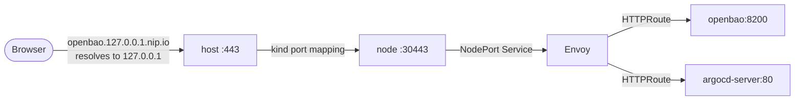

Every platform UI is reachable over HTTPS on a stable hostname, with a certificate your machine trusts, and no port-forwards.

| URL | What |
|---|---|
| `https://argocd.127.0.0.1.nip.io` | Argo CD |
| `https://openbao.127.0.0.1.nip.io` | OpenBao API and UI |

It's the foundation for what comes next: single sign-on needs HTTPS issuer and callback URLs, and PR previews need per-preview hostnames.

## The path of a request

- **nip.io** resolves `<anything>.127.0.0.1.nip.io` to `127.0.0.1`: no DNS to configure.
- **kind** maps the host's `127.0.0.1:80/443` to fixed NodePorts. It has no load balancer, so an `EnvoyProxy` resource sets the Envoy Service to `NodePort` with those exact ports.
- **One Gateway** (Gateway API, implemented by Envoy Gateway) listens on `*.127.0.0.1.nip.io`. Port 80 only redirects to HTTPS. Each UI attaches an `HTTPRoute` from its own namespace.
- **cert-manager** issues one wildcard certificate, signed by a local CA.

## A CA that survives the cluster

A CA created inside the cluster would change every time the cluster is re-created, and you would have to trust a new one each time. Instead, `make local-ca` generates it once on your machine with `openssl`, into `.local-ca/` (git-ignored). Each new cluster gets it as a bootstrap Secret, and cert-manager signs with it. You trust it once per machine with `make local-ca-trust`.

## Gotchas

- **macOS rejects TLS certificates without the `serverAuth` usage.** cert-manager doesn't add it by default, so the certificate lists it explicitly.
- **Inside the cluster, `127.0.0.1.nip.io` hostnames point to the caller itself**, not to the Gateway. Nothing needs them in-cluster yet. Single sign-on will, and will need a CoreDNS rewrite.
- **Envoy Gateway's Argo CD Application goes `Degraded` briefly on a fresh cluster**, right after its certificate-generation hook. It lasted 3.5 minutes on one run and 8 seconds on another, and the cause isn't pinned down yet. The root Application's retry absorbs it.

Verified on fresh clusters with both install paths, and in CI on every pull request: the `301` redirect, the certificate checked against the local CA only, OpenBao answering, and an Argo CD login through the Gateway.

Reference: [`docs/gateway.md`](https://github.com/idPlatformKit/Orchestrator/blob/main/docs/gateway.md).
