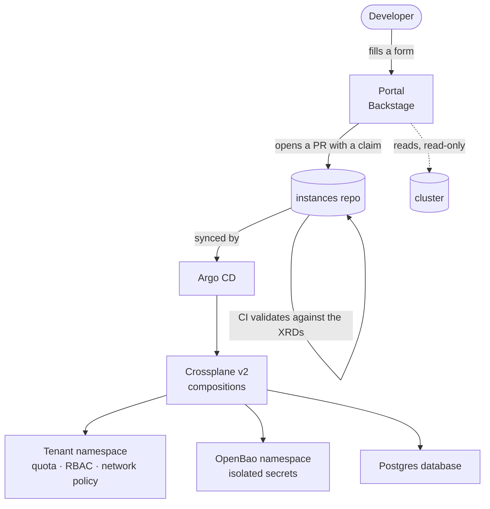

IdPlatformKit separates **what a team asks for** from **how the platform delivers it**. Teams declare claims, small YAML objects that describe an intent. The platform owns the compositions that turn those claims into real resources.

## The flow

Verified end to end: a developer ran the New Tenant template in the browser, the pull request was opened under their GitHub identity, CI validated the claim in 11 seconds, and after the merge Argo CD applied it and Crossplane provisioned the tenant.

## Layers

| Layer | Lives in | Contains | Changed by |
|---|---|---|---|
| Platform services | `Orchestrator/platform/`, `providers/` | Crossplane, providers and functions, shared Postgres and OpenBao, External Secrets Operator, cert-manager, Envoy Gateway | The platform team |
| Platform APIs | `Orchestrator/compositions/` | One XRD and one Composition per API: `Tenant`, `PostgresDatabase` | The platform team |
| Claims | `instances/` | One file per tenant or database, plus a catalog entity | Developers, through pull requests |
| Portal | `portal/` | Templates that open those pull requests, the catalog, the Kubernetes view | The platform team |

The same `providers/`, `compositions/` and `platform/` files are used by both install paths, the direct one (`make local-up`) and the GitOps one (`make local-up-gitops`). There's one source of truth, never a copy per environment.

## Platform APIs

| API | Scope | What a team gets |
|---|---|---|
| [`Tenant`](/architecture/tenant/) | Cluster | A namespace baseline, and optionally an isolated OpenBao namespace with secrets delivered as Kubernetes `Secret`s |
| [`PostgresDatabase`](/architecture/postgres-database/) | Namespaced | A logical database and role on the shared server, connection details in a `Secret` |

Both follow one pattern: a backing service installed once for the cluster, and a composition that hands each claim its own slice of it (a database and a role, an OpenBao namespace) rather than a dedicated instance. That keeps a laptop cluster small. It's a deliberate trade-off, not a claim about multi-tenant production at scale.

## Access paths

- **Developers** never get cluster-admin. They change the platform through pull requests to `instances`, and get `edit` on their own namespace through their GitHub team.
- **The portal** reads the cluster through a read-only ServiceAccount, `backstage-reader`, which has no access to Secrets: a request for a tenant's Secrets returns `403`.
- **Platform UIs** (Argo CD, OpenBao) are served over HTTPS behind one Gateway. See [HTTPS on kind](/architecture/https/).

## Further reading

- [Orchestrator `docs/architecture.md`](https://github.com/idPlatformKit/Orchestrator/blob/main/docs/architecture.md), the reference for this page.
- [Design decisions](/architecture/decisions/), the reasons behind each building block.
