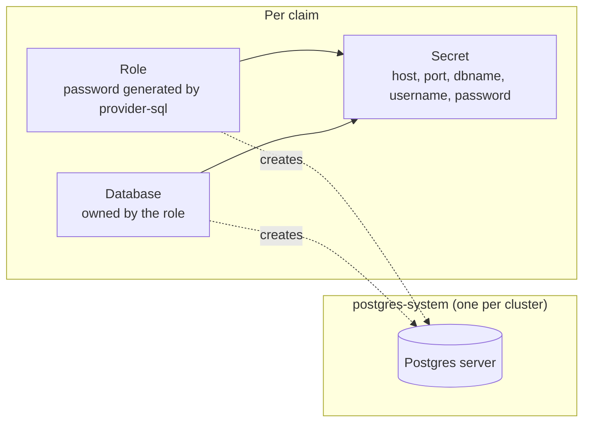

A `PostgresDatabase` gives a team a logical database and a role on the platform's shared Postgres server, with the connection details in a `Secret` of its namespace.

```yaml
apiVersion: database.idplatformkit.io/v1alpha1
kind: PostgresDatabase
metadata:
  name: orders
  namespace: payments
spec:
  writeConnectionSecretToRef:
    name: orders-conn
```

In practice a team doesn't write this by hand: the portal's New Postgres database template asks which tenant and which name, and opens the pull request.

## How it works



- **A shared server, not one per claim.** `provider-sql` creates a role and a database on it for each claim.
- **The role owns the database**, so it has full rights on what it creates without a separate grant.
- **The password never appears in the composition.** `provider-sql` generates it and writes it to a connection secret; the composition only reads it back to build the claim's `Secret`.

Verified beyond `Ready`: the generated credentials were used for a real `psql` session that created a table, inserted and read rows.

## Server-side names: a security fix

All tenants share one server, so names must be unique across namespaces. The first version named the role and the database after the claim's name only. Reproduced on kind with two throwaway namespaces:

1. `pg-victim/shared-name` was created, and data was written into the `shared-name` database.
2. `pg-attacker/shared-name` also became `Ready`. Its role and database **adopted** the existing ones. Its `Secret` had no credentials, so nothing leaked.
3. Deleting `pg-attacker/shared-name` **dropped the victim's database and role**. The victim's claim still reported `Ready` a minute later.

Any team could destroy another team's database by knowing its name ([#21](https://github.com/idPlatformKit/Orchestrator/issues/21)).

Roles and databases are now named `<namespace>_<name>`, through Crossplane's external-name annotation. Kubernetes names can't contain `_`, so two different claims never map to the same identifier, and a team can only create claims in its own namespace. The same scenario afterwards left the victim's data intact.

Changing the naming scheme doesn't rename anything on the server: Crossplane created new objects under the new names and left the old ones unmanaged. On this dev setup, the one existing database was empty and was dropped by hand. With real data, each database would have to be copied first.

## Limits

- Postgres truncates identifiers over 63 bytes: keep `<namespace>_<name>` shorter.
- One shared, single-replica server in dev mode with a fixed admin password. A [prod-like profile](/roadmap/) with CloudNativePG and backups is on the roadmap.

Reference: [`docs/compositions/postgres-database.md`](https://github.com/idPlatformKit/Orchestrator/blob/main/docs/compositions/postgres-database.md).
