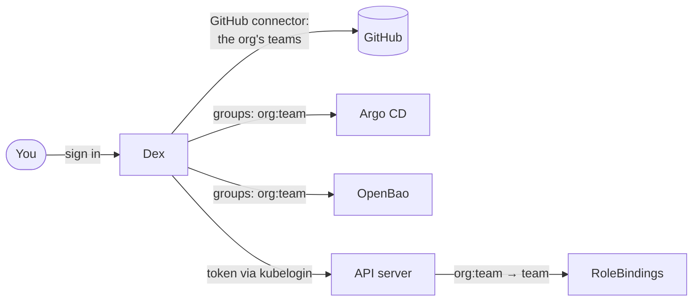

People sign in with GitHub, and **their teams in the installation's org are their groups everywhere**. Adding someone to a team gives them access; removing them takes it away. Nobody shares an admin token.

| Where | What your teams give you |
|---|---|
| **kubectl** (`make kubeconfig-sso`, through kubelogin) | `edit` on the namespaces of your teams' tenants. `cluster-admin` for `platform-admins` |
| **Argo CD** ("Log in via GitHub") | Read for every org member, admin for `platform-admins` |
| **OpenBao** (OIDC, with a role) | Role `tenant-<name>`: the secrets of a tenant your team owns, and nothing else. Role `admin`: everything, for `platform-admins` |
| **Portal** | Ownership of your teams' tenants and databases |

The portal keeps its own GitHub sign-in: it opens pull requests with your GitHub token, which Dex doesn't provide.

## How it fits together

- **Dex** is the platform's OIDC issuer, at `https://dex.127.0.0.1.nip.io`. Its GitHub connector only reads the installation's org and sends its teams as groups, like `idpk-test:team-a`.
- **The API server** trusts Dex through a structured authentication configuration, with a CEL expression that keeps only the team: `idpk-test:team-a` becomes `team-a`. That's the name a Tenant's `ownerGroup` already uses for its `RoleBinding`, so the binding created at the very first milestone now serves real people.
- **OpenBao** has an `oidc` auth method. Each Tenant creates a role for its owner team, matched with a glob, `*:team-a`: Dex only sends the installation's org, so the glob can't match anything else, and nothing in Git names the org.

## The hard part: reaching Dex from inside the cluster

Tokens carry their issuer, `https://dex.127.0.0.1.nip.io`, so Argo CD, OpenBao and the API server must reach Dex at that exact URL. But `127.0.0.1.nip.io` names resolve to `127.0.0.1`: inside a pod, that's the pod itself; on the node, where the API server runs, the node itself.

Inside the cluster, these names now resolve to the platform Gateway, which serves them with the same certificate as for the browser:

- the Gateway's Service has a **fixed ClusterIP**;
- **pods**: CoreDNS answers every `*.127.0.0.1.nip.io` name with it;
- **the API server** runs on the node's network and doesn't use CoreDNS: a `hostAliases` entry on its static Pod points Dex's name at the Gateway. Whether the kubelet honours `hostAliases` on a host-network Pod was checked by hand before relying on it.

## What was learned on the way

- **The CEL mapping didn't compile at first.** Claims are untyped, and `claims.groups.map(...)` was refused at API server start-up: `expression of type 'any' cannot be range...`. The cluster never came up. `dyn(claims.groups)` fixed it, and `kind create cluster --retain` keeps the node to read the API server's logs.
- **CI ran an older kind.** It wrote a different kubeadm configuration version, which the patches didn't fit. The kind version and the Kubernetes node image are now pinned, and `make setup` checks the kind version.
- **A team policy in OpenBao's root namespace reaches the tenant's namespace** through its path prefix. Checked by hand first: allowed in `demo`, refused in another tenant's namespace.
- **The OpenBao UI stuck on its logo, in Firefox only**, after several cluster re-creations: a stale token in the browser's local storage. A private window, or clearing the site's data, fixes it.

Verified on kind with a test org: Argo CD admin through `platform-admins`, `kubectl auth whoami` showing the team groups, a team member allowed in its tenant's namespace and refused elsewhere, and OpenBao's `tenant-demo` role reading only `demo`'s secrets.

Reference: [`docs/sso.md`](https://github.com/idPlatformKit/Orchestrator/blob/main/docs/sso.md).
